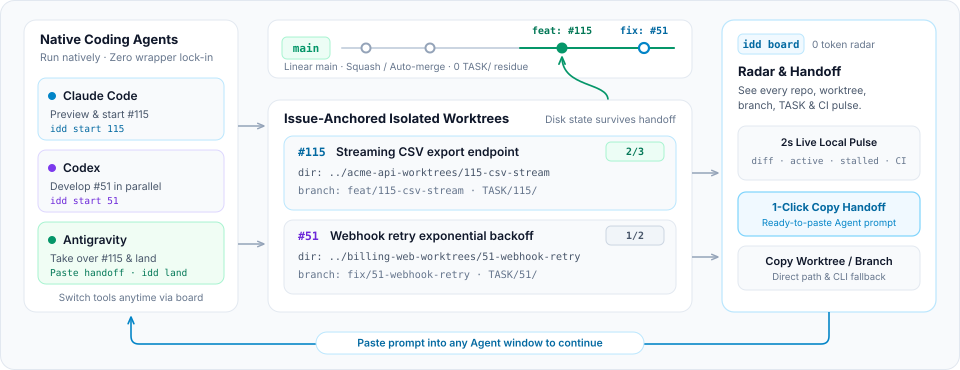

<a id="readme-top"></a>

<div align="center">

# IDD

**Issue-Driven Development · Isolated Parallel Workflow & 1-Click Handoff for AI Coding Agents**

Run **Claude Code**, **Codex**, and **Antigravity** natively in parallel without stepping on each other's files—<br />
track every worktree on a zero-token local board and hand off context to any agent in one click.

[简体中文](README.md) · **English**

[](https://github.com/j-tide/idd/releases)
[](https://github.com/j-tide/idd/stargazers)
[](https://github.com/j-tide/idd/actions/workflows/ci.yml)
[](#supported-ecosystem)
[](#supported-ecosystem)
[-8b5cf6?style=flat-square)](#development-testing--releases)

[Why IDD](#why-idd) · [Key Features](#key-features) · [How It Works](#how-it-works) · [Quick Start](#quick-start) · [Ecosystem](#supported-ecosystem) · [CLI Reference](#cli-reference--naming-conventions) · [Star History](#star-history)

</div>

<p align="center">
  <picture>
    <source media="(prefers-color-scheme: dark)" srcset="assets/board-en-dark.png" />
    <source media="(prefers-color-scheme: light)" srcset="assets/board-en-light.png" />
    
  </picture>
  <br />
  <sub><em><code>idd board</code> local Web radar: zero-token visibility into every repo's worktree pulse, <code>TASK</code> progress, and CI status—with 1-click cross-agent handoff and EN / 中文 switching.</em></sub>
</p>

---

## Why IDD

When you run multiple AI coding tools at once, two bottlenecks hit immediately: **agents collide in the same working directory**, and when one model stalls or hits a quota limit, **your progress and context stay trapped in that chat window**.

| Dimension | Ad-Hoc Multi-Window AI | Heavy Wrapper IDE / Orchestrator | **IDD** |
| :--- | :--- | :--- | :--- |
| **Native Experience** | Native windows, no extra lock-in | Forces a custom UI or wrapper | **Keep Claude Code, Codex, and Antigravity native** |
| **Parallel Isolation** | Shared directory, frequent conflicts | Proprietary sandboxes or containers | **Dedicated physical Git Worktree per Issue** |
| **Cross-Agent Handoff** | Manual copy-paste of chat history | Restricted to built-in model swaps | **On-disk `TASK/` ledger + 1-click Copy Handoff** |
| **Global Visibility** | Check chat tabs one by one | Extra daemon & token overhead | **Zero-token local Web board (2s pulse) & terminal watch** |
| **Git & Merge Hygiene** | Messy merge commits or `main` edits | Local-only or platform-locked state | **GitHub & GitLab native, CI self-healing, linear Squash to `main`** |
| **Dependencies & Footprint** | None | Heavy runtime & configuration | **0 dependencies (Python 3 stdlib + sh), zero Git hooks** |

IDD connects three lightweight pieces into a single loop that you drive with natural language:

- **Shared Agent Skill (`SKILL.md`)**: Teaches Claude Code, Codex, and Antigravity the same workflow—align visually first, anchor scope to a GitHub / GitLab **Issue**, develop inside an isolated **Git Worktree**, and track steps in `TASK/<issue>/`.
- **Zero-Token Radar & Handoff Launchpad (`idd board`)**: Aggregates active worktree diffs, `TASK` steps, and PR/MR CI status across all local repos; click **Copy Handoff** anytime to resume seamlessly in another agent window.
- **Deterministic Under-the-Hood CLI (`idd`)**: Invoked automatically by agents to handle worktree creation, `.env` (`.worktreeinclude`) syncing, 8-prefix branch validation, PR/MR summaries, CI log inspection, and linear **Squash merges**.

---

## Key Features

<table>
  <tr>
    <td width="50%" valign="top">
      <h3>Issue-Anchored · Physical Worktree Parallelism</h3>
      Every Issue gets an isolated directory at <code>../&lt;repo&gt;-worktrees/&lt;id&gt;-&lt;slug&gt;</code> and a validated <code>&lt;type&gt;/&lt;id&gt;-&lt;slug&gt;</code> branch (<code>--no-track</code> + immediate push to <code>origin</code>), automatically copying <code>.env</code> files listed in <code>.worktreeinclude</code>.
    </td>
    <td width="50%" valign="top">
      <h3>Visual Alignment · Local Preview Workbench (<code>idd preview</code>)</h3>
      Show before you code. Preview interactive HTML prototypes with hot reload, side-by-side A/B comparison, and desktop / tablet / mobile viewports—kept outside your project repo so your working tree stays clean.
    </td>
  </tr>
  <tr>
    <td width="50%" valign="top">
      <h3>Zero-Token Radar · 1-Click Cross-Agent Handoff</h3>
      <code>idd board</code> (2s local pulse, 30s remote cache) and <code>idd watch</code> display changed files, <code>+insertions/-deletions</code>, <code>TASK</code> progress, and CI status—complete with a browser token setup wizard, EN / 中文 toggle, and 1-click Copy Handoff / path / branch.
    </td>
    <td width="50%" valign="top">
      <h3>CI Self-Healing · Opt-In Auto-Merge (<code>auto-merge</code>)</h3>
      <code>idd pr</code> / <code>idd mr</code> summarizes <code>TASK</code> and test records with <code>Closes #id</code>; failing CI triggers log inspection capped at 2 targeted fix rounds. Toggle global or per-repo <code>auto-merge</code> via CLI or the board top bar (auto-pauses on Drafts, conflicts, or evidence files).
    </td>
  </tr>
  <tr>
    <td width="50%" valign="top">
      <h3>Linear Squash History · Zero Leftover Clutter</h3>
      <code>idd land</code> rebases onto <code>main</code>, writes the full <code>TASK</code> summary into the PR/MR and Squash commit body, cleans up temporary <code>TASK/&lt;issue&gt;/</code> files, Squash-merges linearly, and checks off Issue acceptance boxes—keeping branches/worktrees safe until <code>idd cleanup</code>.
    </td>
    <td width="50%" valign="top">
      <h3>Dual-Forge Native · Zero Dependencies · Zero Hooks</h3>
      Built purely with Python 3 stdlib + POSIX <code>sh</code> for GitHub, GitHub Enterprise, and Self-Hosted GitLab (<code>ff</code> + <code>squash</code>). Rejects noisy branch prefixes without writing Git hooks into your repos, and safely fast-forwards every 6 hours.
    </td>
  </tr>
</table>

---

## How It Works

<p align="center">
  <picture>
    <source media="(prefers-color-scheme: dark)" srcset="assets/workflow-en-dark.svg" />
    <source media="(prefers-color-scheme: light)" srcset="assets/workflow-en-light.svg" />
    
  </picture>
</p>

1. **Align visually, then anchor an Issue**: Discuss scope in any agent window—reviewing an interactive HTML prototype (`idd preview`) or Before/After sample first when UI or output changes—then say *"Create an Issue with idd"*. Your working tree stays untouched.
2. **Run multiple agents in isolated worktrees**: Tell **Claude Code** *"Start #115"* while **Codex** runs *"Start #51"*. Each task enters its own physical worktree, gets `.env` synced, and maintains its own `TASK/<issue>/` ledger.
3. **Monitor on `idd board` & hand off in one click**: Watch live diff pulses, task bars, and CI checks without burning tokens. Need to switch tools? Click **Copy Handoff** and paste it into **Antigravity** or any other agent to continue right from `TASK/`.
4. **Land a single linear commit onto `main`**: Tell the final agent *"Land #115"* (or enable `idd config auto-merge on` / the board top-bar switch so green PRs/MRs land automatically). IDD cleans `TASK/`, checks off Issue acceptance boxes, and Squash-merges cleanly.

```text
~/code/
├── my-app/                                  # Main repo (stays clean on main)
└── my-app-worktrees/                        # Isolated parallel worktrees managed by IDD
    ├── 115-export-csv/                      # ← Claude Code working on feat/115-export-csv
    │   ├── .env                             #   Synced from .worktreeinclude
    │   └── TASK/115-export-csv/             #   On-disk task ledger (cleaned before Squash merge)
    │       ├── TASK-01-csv-serializer.md    #   Status: done
    │       └── TASK-02-stream-endpoint.md   #   Status: in_progress
    └── 51-fix-dark-flicker/                 # ← Codex working concurrently on fix/51-fix-dark-flicker
        └── TASK/51-fix-dark-flicker/
```

---

## Quick Start

Prerequisites: `git` and `python3` installed locally.

### 1. Install the shared skill & global `idd` CLI

```bash
curl -fsSL https://raw.githubusercontent.com/j-tide/idd/main/install.sh | sh
```

### 2. Launch the local board & connect your forge

```bash
idd board
```

> On first launch, `idd board` opens a browser setup wizard where you can generate and paste a GitHub or self-hosted GitLab token directly—no CLI login command required.

### 3. Drive everything with natural language in any agent

| Stage | Say to your Agent | Under-the-hood Action |
| :--- | :--- | :--- |
| **Align & open Issue** | *"Preview a prototype first, then open an IDD Issue"* | `idd preview` → `idd issue create` |
| **Parallel execution** | *"Start #115"* (and *"Start #51"* in another window) | `idd start` creates worktree & pushes branch |
| **Switch agents anytime** | Click **Copy Handoff** in `idd board` and paste into another agent | `idd start` reuses worktree & resumes `TASK/` |
| **Review & land** | *"Open a PR"* / *"Land #115"* | `idd pr` → `idd ci --watch` → `idd land` |

> [!TIP]
> Run `idd repo-init --apply` once per repository (also auto-detected on first `idd start` / `idd issue create`) to enforce Squash-only linear merges on GitHub or `ff` + `squash` on GitLab while preserving branches. Want CI-green PRs/MRs to merge automatically? Run `idd config auto-merge on` or toggle it in the `idd board` top bar.

> [!NOTE]
> `idd` safely checks `origin/main` in the background every 6 hours and fast-forwards only when your local skill clone is on a clean `main` branch (or run `idd upgrade [--check]` anytime). To uninstall cleanly without touching any project repository, run `idd uninstall` (or `curl -fsSL https://raw.githubusercontent.com/j-tide/idd/main/install.sh | sh -s -- --uninstall -y`).

<details>
<summary><strong>Optional: Set IDD as Your Default Workflow</strong> (Global User Rules / Project <code>AGENTS.md</code> templates — installer never writes these automatically)</summary>

`install.sh` only symlinks the shared Skill and `idd` CLI, and `idd repo-init` only configures remote merge rules—**neither creates or edits any global rules or project `AGENTS.md` automatically**. If you want IDD active by default, copy one of the snippets below:

### Option 1: Personal Global Default (Recommended — keeps project repos untouched)

Add this snippet to your agent's user-level global instructions:

- **Claude Code**: `~/.claude/CLAUDE.md`
- **Codex**: `~/.codex/AGENTS.md`
- **Antigravity**: Global User Rules (`~/.gemini/GEMINI.md` or User Rules settings)

```markdown
# Global Development Workflow (IDD)

Default to the global `idd` skill (`~/.agents/skills/idd/SKILL.md`) for all non-read-only code, config, and documentation tasks.

- **Issue first, then isolated worktree**: When a repo has a GitHub / GitLab remote and no linked Issue yet, run `idd issue create`, then `idd start <issue#>` to create or reuse an isolated worktree and `<type>/<id>-<slug>` branch pushed to `origin` (never edit directly on `main`).
- **Per-TASK verification & immediate push**: Break work down under `TASK/<issue>/TASK-XX-*.md` with test mappings, verify with real tests, commit per task, and push right away via `idd sync` (or `git push -u origin HEAD`).
- **PR/MR, CI & linear merge**: Run `idd pr` / `idd mr` and `idd ci --watch`; once approved (or when `auto_merge` is enabled), run `idd land` to clean `TASK/<issue>/` and Squash-merge linearly onto `main`.
- **Safety boundaries**: Use the unnumbered `<slug>` flow only in local-only repos without remotes; protect uncommitted edits and never force-push or merge into `main`, deploy, or touch production without authorization.
```

### Option 2: Project-Level Enforcement (Shared with collaborators)

To enforce IDD across all contributors in a repository, add the snippet below to the repository's root `AGENTS.md` (and put `@AGENTS.md` in `CLAUDE.md` if teammates use Claude Code), optionally paired with `idd repo-init --apply` and remote `main` branch protection:

```markdown
# Repository Workflow (IDD)

This repository uses the `idd` skill (Issue-Driven Development) for all changes:
- Create an Issue with `idd issue create`, then develop in an isolated worktree and `<type>/<id>-<slug>` branch via `idd start <issue#>`—never commit directly to `main`.
- Track steps and real test results under `TASK/<issue>/`; commit per task and push with `idd sync`.
- Open a PR/MR via `idd pr` / `idd mr`, wait for green CI, and land with `idd land` to remove temporary `TASK/` files and Squash-merge onto `main`.
```

</details>

---

## Supported Ecosystem

| Category | Supported Target | Integration & Capabilities |
| :--- | :--- | :--- |
| **AI Agents** | **Claude Code** | Symlinked to `~/.claude/skills/idd` |
| **AI Agents** | **Codex** | Symlinked to `~/.codex/skills/idd` |
| **AI Agents** | **Antigravity** | Symlinked to `~/.gemini/config/skills/idd` |
| **Git Forges** | **GitHub / GitHub Enterprise** | Native Issue progress bars, PR summaries, Actions CI logs, linear `Squash` merges |
| **Git Forges** | **Self-Hosted GitLab** | Native Issue progress bars, MR summaries, Pipeline logs, `ff` + `squash` linear merges |

---

## CLI Reference & Naming Conventions

<details>
<summary><strong>Expand full CLI command table, 8 standard prefixes & zero-hook guardrails</strong> (mostly invoked by Agents, or runnable manually)</summary>

### Common Commands

| Command | Description |
| :--- | :--- |
| `idd board` / `idd ui` | Start the offline Web radar & 1-click handoff board (2s live worktree pulse, bilingual 中文 / EN) |
| `idd preview <target>... [--compare]` | Launch the local prototype preview workbench (hot reload, side-by-side A/B compare, and responsive viewports) |
| `idd watch [--current-only]` | Live terminal monitor for global or single-repo worktrees, tasks, and CI |
| `idd status [-g\|--global]` | One-shot terminal summary of Open Issues, `TASK` progress, pulse, and PR/MR CI |
| `idd repos [list\|add\|remove\|prune]` | Inspect or manage the global monitored repository index (`~/.config/idd/repos.json`) |
| `idd issue create --title "..." [--type ...] [--scope ...]` | Create a GitHub or GitLab Issue with validated title |
| `idd start <issue# \| slug>` | Create or idempotently reuse an isolated worktree, create `--no-track` branch & push to `origin`, and sync `.worktreeinclude` |
| `idd sync [issue#]` | Sync local `TASK` checklist progress back to the Issue body and auto-push branch commits |
| `idd pr` / `idd mr` | Summarize `TASK` and test records (`Closes #id`) to create or update a PR / MR (auto-waits CI & lands when `auto_merge` is enabled; `--auto-merge` / `--no-auto-merge`) |
| `idd ci [issue# \| pr# \| !mr#] [--logs]` | Check PR / MR CI status and fetch failing job logs |
| `idd land [issue# \| slug]` | Rebase, clean `TASK/<issue>/`, Squash-merge onto `main`, and auto-check Issue acceptance boxes (keeps branches & worktrees by default; optional `--wait-ci` / `--no-check-acceptance` / `--rm-worktree`) |
| `idd cleanup [--dry-run]` | Safely remove merged worktree directories when clean and `HEAD == headRefOid` (**never deletes branches**) |
| `idd repo-init [--apply]` | Check or apply linear Squash merge rules with branch retention on GitHub / GitLab |
| `idd config [auto-merge on\|off\|inherit] [-g]` | View or toggle global and per-repository PR/MR auto-merge switches (off by default) |
| `idd auth login / status / logout` | Manage credentials for self-hosted GitLab or GitHub Enterprise hosts |
| `idd upgrade [--check]` | Check for updates or fast-forward `idd` (`idd --version` prints current version) |
| `idd uninstall [--dry-run] [--keep-config] [-y]` | Completely remove `idd` symlinks, skill clone, config, and cache |

### Issue & Branch Naming (Zero Git Hooks)

Issue titles, branches, and commit `<type>` tags share **8 standard prefixes**:

```text
feat · fix · refactor · perf · docs · test · ci · chore
```

- **Issue titles**: `<type>: <summary>` or `<type>(<scope>): <summary>` (optional lowercase `scope` ≤ 16 chars).
- **Branch naming**: `<type>/<issue#>-<slug>` for Issue worktrees, or `<type>/<slug>` for local-only repositories.
- **Zero-hook guardrails**: `idd` blocks tool-specific or noisy prefixes (`codex/*`, `claude/*`, `agy/*`, `feature/*`, `bugfix/*`, `tmp/*`) with an exact `git branch -m` fix command—without writing any Git hooks into your repositories.

</details>

---

## Development, Testing & Releases

Zero external dependencies—run the Python 3 standard-library test suite directly, with [SKILL.md](SKILL.md) (`metadata.version`) as the single source of truth:

```bash
# Run the full unit test suite
python3 -m unittest discover -s tests -v

# Verify version consistency across SKILL.md, READMEs, and CLI
python3 scripts/release.py --check

# Bump version, tag, and push release
python3 scripts/release.py patch --tag --push
```

---

## Star History

<a href="https://www.star-history.com/#j-tide/idd&Date">
  <picture>
    <source media="(prefers-color-scheme: dark)" srcset="https://api.star-history.com/svg?repos=j-tide/idd&type=Date&theme=dark" />
    <source media="(prefers-color-scheme: light)" srcset="https://api.star-history.com/svg?repos=j-tide/idd&type=Date" />
    
  </picture>
</a>

---

<div align="center">
  <sub>If IDD helps you run multiple AI coding agents cleanly in parallel, consider leaving a ⭐ Star or opening an <a href="https://github.com/j-tide/idd/issues">Issue</a> / <a href="https://github.com/j-tide/idd/pulls">PR</a>.</sub>
</div>

<p align="right"><a href="#readme-top">↑ Back to top</a></p>
