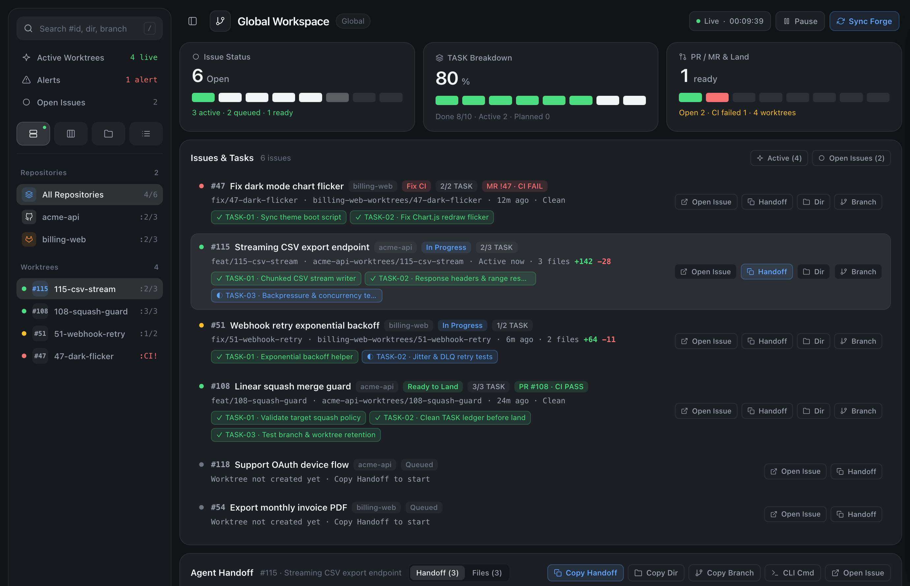

<div align="center">

# IDD

**Run Claude Code, Codex, and Antigravity in parallel without stepping on each other—track every worktree on a local board and hand off to any agent in one click.**

[简体中文](README.md) · **English**

[](https://github.com/j-tide/idd/releases)
[](#)
[-8b5cf6?style=flat-square)](#)
[](#)

</div>

<p align="center">
  <picture>
    <source media="(prefers-color-scheme: dark)" srcset="assets/board-en-dark.png" />
    <source media="(prefers-color-scheme: light)" srcset="assets/board-en-light.png" />
    
  </picture>
</p>

---

## What IDD Actually Is

When you run multiple AI coding tools at the same time, two problems show up fast: agents step on each other's files in one working directory, and when one model stalls or hits a quota limit, your context is trapped in that chat window.

**IDD fixes this without locking you into a heavy wrapper UI.** You keep using Claude Code, Codex, and Antigravity natively, while three lightweight pieces work as one loop:

- **Shared Agent Skill (`SKILL.md`)**: Teaches every agent the exact same workflow—anchor work to a GitHub or GitLab **Issue**, develop inside an isolated **Git Worktree**, and record step-by-step progress in `TASK/<issue>/` on disk.
- **Local Radar & Handoff Launchpad (`idd board`)**: Open a zero-token browser radar showing every active repository, worktree directory, branch, `TASK` progress, and CI status. When you want another agent to take over, click **Copy Handoff** (or copy the worktree path / branch directly) and paste it into any other agent window (with built-in EN / 中文 switching).
- **Deterministic Under-the-Hood CLI (`idd`)**: Handles worktree creation, `.worktreeinclude` (`.env`) syncing, branch-prefix validation, PR/MR summaries, CI log inspection, and linear **Squash merges** onto `main` when agents invoke it—no Git plumbing commands to memorize.

---

## How Daily Handoff Works

<p align="center">
  <picture>
    <source media="(prefers-color-scheme: dark)" srcset="assets/workflow-en-dark.svg" />
    <source media="(prefers-color-scheme: light)" srcset="assets/workflow-en-light.svg" />
    
  </picture>
</p>

1. **Turn a chat into an Issue anchor**: Align on scope in any agent window and ask it to open an Issue (for example, *"Create an Issue for streaming CSV export"*). Your working tree stays untouched.
2. **Run multiple agents in parallel**: Tell **Claude Code** *"Start #115"* and **Codex** *"Start #51"*. Each task gets its own physical worktree directory, validated branch, `.env` copy, and `TASK/<issue>/` ledger—zero conflicts.
3. **Glance at `idd board` & switch agents in one click**: Watch live file diffs, task steps, and CI status without interrupting any agent. Need to swap tools? Click **Copy Handoff** (or copy the worktree path / branch) on any row or console, paste into **Antigravity** (or any other agent), and continue right from `TASK/`.
4. **Land a single linear commit onto `main`**: Once CI is green, tell the active agent *"Land #115"*. IDD rebases onto `main`, writes the `TASK` summary into the PR/MR and commit body, removes temporary `TASK/<issue>/` files, and Squash-merges cleanly—while keeping your branch and worktree safe until you run `idd cleanup`.

*(Tip: run `idd repo-init --apply` once per repository to enforce Squash-only linear merges on GitHub or `ff` + `squash` on GitLab while preserving branches.)*

---

## Quick Start

Prerequisites: `git` and `python3` (`idd board` includes a first-run setup wizard where you can open your GitHub / self-hosted GitLab token page, paste the token, and save directly in the browser—no CLI login command required).

```bash
# 1. Install the shared skill for Claude Code, Codex, and Antigravity + global `idd` CLI
curl -fsSL https://raw.githubusercontent.com/j-tide/idd/main/install.sh | sh

# 2. Open the local worktree radar & 1-click handoff board
idd board
```

> `idd` safely checks `origin/main` in the background every 6 hours and fast-forwards only when your local skill repo is on a clean `main` branch (or run `idd upgrade [--check]`). Run `idd uninstall` (or `curl -fsSL https://raw.githubusercontent.com/j-tide/idd/main/install.sh | sh -s -- --uninstall -y`) anytime for clean removal without touching your project repositories.

---

<details>
<summary><strong>CLI Reference &amp; Branch Naming Rules</strong> (mostly called automatically by Agents, or runnable by hand)</summary>

### Common Commands

| Command | Description |
| :--- | :--- |
| `idd board` / `idd ui` | Start the offline Web radar & 1-click handoff board (2s live worktree pulse, bilingual 中文 / EN) |
| `idd watch [--current-only]` | Live terminal monitor for global or single-repo worktrees, tasks, and CI |
| `idd status [-g\|--global]` | One-shot terminal summary of Open Issues, `TASK` progress, pulse, and PR/MR CI |
| `idd repos [list\|add\|remove\|prune]` | Inspect or manage the global monitored repository index (`~/.config/idd/repos.json`) |
| `idd issue create --title "..." [--type ...] [--scope ...]` | Create a GitHub or GitLab Issue with validated title |
| `idd start <issue# \| slug>` | Create or idempotently reuse an isolated worktree, create `--no-track` branch & push to `origin`, and sync `.worktreeinclude` |
| `idd sync [issue#]` | Sync local `TASK` checklist progress back to the Issue body and auto-push branch commits |
| `idd pr` / `idd mr` | Summarize `TASK` and test records (`Closes #id`) to create or update a PR / MR |
| `idd ci [issue# \| pr# \| !mr#] [--logs]` | Check PR / MR CI status and fetch failing job logs |
| `idd land [issue# \| slug]` | Rebase, clean `TASK/<issue>/`, Squash-merge onto `main`, and auto-check Issue acceptance boxes (keeps branches & worktrees by default; optional `--no-check-acceptance` / `--rm-worktree`) |
| `idd cleanup [--dry-run]` | Safely remove merged worktree directories when clean and `HEAD == headRefOid` (**never deletes branches**) |
| `idd repo-init [--apply]` | Check or apply linear Squash merge rules with branch retention on GitHub / GitLab |
| `idd auth login / status / logout` | Manage credentials for self-hosted GitLab or GitHub Enterprise hosts |
| `idd upgrade [--check]` | Check for updates or fast-forward `idd` (`idd --version` prints current version) |
| `idd uninstall [--dry-run] [--keep-config] [-y]` | Completely remove `idd` symlinks, skill clone, config, and cache |

### Issue &amp; Branch Naming (Zero Git Hooks)

Issue titles, branches, and commit `<type>` tags share **8 standard prefixes** (Issue titles use `<type>: <summary>` or `<type>(<scope>): <summary>` with an optional short lowercase `scope` ≤ 16 chars; branches use `<type>/<issue#>-<slug>` for Issue worktrees or `<type>/<slug>` for local-only branches):

`feat` · `fix` · `refactor` · `perf` · `docs` · `test` · `ci` · `chore`

`idd` rejects tool-specific or noisy prefixes (`codex/*`, `claude/*`, `agy/*`, `feature/*`, `bugfix/*`, `tmp/*`) with an exact `git branch -m` fix command—without writing any Git hooks into your repositories.

</details>

---

## Development, Testing & Releases

Zero external dependencies—run the Python standard-library test suite directly, with [SKILL.md](SKILL.md) (`metadata.version`) as the single source of truth:

```bash
python3 -m unittest discover -s tests -v
python3 scripts/release.py --check
python3 scripts/release.py patch --tag && git push origin main && git push origin v0.0.2
```
