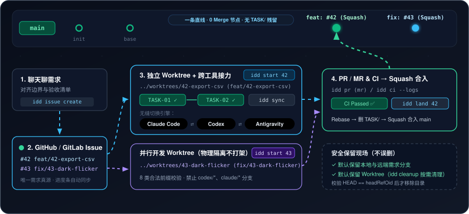

<div align="center">

# IDD (Issue-Driven Development)

**让 Claude Code、Codex 与 Antigravity 共用同一套 Issue 驱动开发流水线**

[](https://github.com/j-tide/idd)
[](https://www.python.org/)
[-8b5cf6?style=flat-square)](#)
[](#)

</div>

<p align="center">
  
</p>

---

## 做什么

写代码前先把想法变成 **GitHub Issue**，然后把**分支、Worktree 目录、`TASK` 账本、PR 汇总和线性合入**统一收口到一个零依赖 Skill + CLI 工具 `idd` 中：

- **聊想法自动建单**：在任意 AI 窗口对齐需求范围与验收标准后，一键生成 GitHub Issue，不污染当前代码工作区。
- **多工具零失忆接力**：Claude Code、Codex、Antigravity 共用同一份目录规范与 `idd start`，任意工具都能直接进同一个 Worktree 读取 `TASK/` 进度无缝接手。
- **独立 Worktree 真并行**：每个 Issue 拥有独立的平行工作树与规范分支，多个需求同时开跑互不干扰；自动同步 `.worktreeinclude`（如 `.env`）。
- **`main` 永远是一条直线**：PR / CI 修复闭环后，`idd land` 自动 rebase、把 `TASK` 汇总写进 PR 与提交正文、合入前清理 `TASK/<goal>/`、执行 **Squash Merge** 零 Merge 节点合入 `main`——同时**默认保留本地与远端需求分支及工作树**，释放空间再按需运行安全校验后的 `idd cleanup`。

---

## 快速安装

前置条件：本机已安装 `git`、`python3` 与 `gh`（GitHub CLI 并已登录）。

```bash
git clone https://github.com/j-tide/idd.git "$HOME/.agents/skills/idd"

# 1. 挂载 Skill 到 Claude Code、Codex 与 Antigravity（同源软链，一改全生效）
mkdir -p "$HOME/.claude/skills" "$HOME/.codex/skills" "$HOME/.gemini/config/skills" "$HOME/.local/bin"
ln -sfn "$HOME/.agents/skills/idd" "$HOME/.claude/skills/idd"
ln -sfn "$HOME/.agents/skills/idd" "$HOME/.codex/skills/idd"
ln -sfn "$HOME/.agents/skills/idd" "$HOME/.gemini/config/skills/idd"

# 2. 挂载共用命令 idd（确保 ~/.local/bin 在 PATH 中）
chmod +x "$HOME/.agents/skills/idd/scripts/idd" "$HOME/.agents/skills/idd/scripts/task_status.py"
ln -sfn "$HOME/.agents/skills/idd/scripts/idd" "$HOME/.local/bin/idd"
```

> **内置安全自动更新**：每 6 小时会在后台异步检查一次 `origin/main`（不阻塞命令）；仅当本地技能仓库处于干净的 `main` 分支且无未推送提交时才自动 `ff-only` 同步。也可随时手动运行 `idd upgrade [--check]`。

---

## 怎么做

<p align="center">
  
</p>

平时只需要四步，全程可随时在不同 AI 工具之间切换：

1. **聊天建单**：在任何工具里聊完想法，说“按 idd 建个 Issue”（或直接 `idd issue create --title "..."`）。
2. **开工 / 接手**：让任意工具执行 `idd start <issue#>`——首次运行自动创建独立 Worktree 并同步 `.env`；换工具接手时再次运行自动幂等复用同一工作树与 `TASK/` 进度。
3. **拆任务、真测试、提 PR**：按 [SKILL.md](SKILL.md) 拆出 `TASK/<goal>/TASK-XX.md` 逐项验证提交（可运行 `idd sync` 把勾选进度条同步到 GitHub Issue），完成后运行 `idd pr` 提 PR；CI 挂了运行 `idd ci --logs` 自动拉取失败日志定位修复。
4. **直线合入 `main`**：验收通过且 CI 全绿后执行 `idd land <issue#>`，自动 rebase、把结构化汇总写入 PR/Squash 提交、清理 `TASK/<goal>/` 后以单条 Squash 提交直线合入 `main`，默认保留需求分支与工作树。

*(首次接管仓库建议运行一次 `idd repo-init --apply`，锁定 GitHub 仅允许 Squash Merge 且合并后保留需求分支。)*

---

## 命令与分支规范

### 常用命令

| 命令 | 说明 |
| :--- | :--- |
| `idd status [--open-only] [--json]` | 一张表聚合 GitHub Open Issues、所有 Worktree 的 `TASK` 进度与 PR/CI 状态 |
| `idd issue create --title "..."` | 创建 GitHub Issue |
| `idd start <issue# \| slug>` | 创建或幂等复用独立 Worktree，同步 `.worktreeinclude` 并校验分支名 |
| `idd sync [issue#]` | 将本地 `TASK` 勾选状态同步到 GitHub Issue 正文（渲染原生进度条） |
| `idd pr [issue# \| slug]` | 汇总 `TASK` 与测试记录（附 `Closes #id`）创建或更新 PR |
| `idd ci [issue# \| pr#] [--logs]` | 检查 PR 的 CI 状态并拉取失败日志 |
| `idd land [issue# \| slug]` | Rebase、清理 `TASK/<goal>/` 并 Squash 直线合入（默认保留分支与工作树，可选 `--rm-worktree`） |
| `idd cleanup [--dry-run]` | 按需清理工作区干净且 `HEAD == headRefOid` 的已合入工作树目录（**不删分支**） |
| `idd repo-init [--apply]` | 检查或配置 GitHub 仓库为仅 Squash 合入且保留分支 |
| `idd upgrade [--check]` | 检查或立即快进更新本地 `idd`（`idd --version` 查看版本） |

### 分支规范（零 Git Hooks 侵入）

分支前缀与 Commit `<type>` 共用以下 **8 类标准词表**（绑定 Issue 为 `<type>/<issue#>-<slug>`，纯本地为 `<type>/<slug>`）：

`feat` · `fix` · `refactor` · `perf` · `docs` · `test` · `ci` · `chore`

> `idd` 内置严格拦截 `codex/*`、`claude/*`、`agy/*`、`feature/*`、`bugfix/*`、`tmp/*` 等不规范前缀，并在报错时给出标准 `git branch -m` 修复命令，不在业务仓库写入任何 Git Hook。

---

## 开发与测试

零外部依赖，使用 Python 3 标准库直接运行全部单元测试：

```bash
python3 -m unittest discover -s tests -v
```
