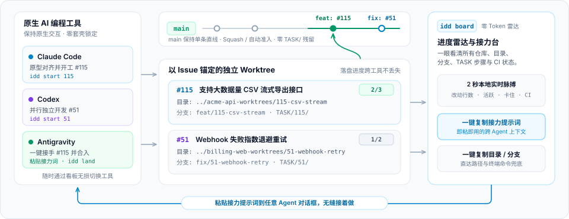

<a id="readme-top"></a>

<div align="center">

# IDD

**Issue-Driven Development · 多 AI 编程 Agent 隔离并行与一键接力工作流**

让 **Claude Code**、**Codex** 与 **Antigravity** 各自在原生窗口中独立并行、互不踩文件；<br />
在零 Token 本地看板实时盯盘，随时一键复制上下文换任意 Agent 接着做。

**简体中文** · [English](README.en.md)

[](https://github.com/j-tide/idd/releases)
[](https://github.com/j-tide/idd/stargazers)
[](https://github.com/j-tide/idd/actions/workflows/ci.yml)
[](#支持生态)
[](#支持生态)
[-8b5cf6?style=flat-square)](#开发测试与发版)

[为什么选择 IDD](#为什么选择-idd) · [核心特性](#核心特性) · [工作原理](#工作原理) · [快速开始](#快速开始) · [支持生态](#支持生态) · [命令速查](#cli-命令与规范速查) · [Star History](#star-history)

</div>

<p align="center">
  <picture>
    <source media="(prefers-color-scheme: dark)" srcset="assets/board-zh-dark.png" />
    <source media="(prefers-color-scheme: light)" srcset="assets/board-zh-light.png" />
    
  </picture>
  <br />
  <sub><em><code>idd board</code> 本地 Web 雷达看板：零 Token 监控所有仓库的 Worktree 脉搏、<code>TASK</code> 进度、CI 状态，并支持一键跨 Agent 接力与中/英切换。</em></sub>
</p>

---

## 为什么选择 IDD

同时用多个 AI 编程工具干活时，最常遇到两个瓶颈：**多个窗口挤在同一个工作区容易互相改乱代码**；而当某一个 Agent 额度耗尽、上下文膨胀或卡住时，**任务进度也跟着锁死在那个聊天框里**。

| 对比维度 | 多窗口裸跑 AI | 重型套壳 IDE / 编排平台 | **IDD** |
| :--- | :--- | :--- | :--- |
| **原生工具体验** | 原生窗口，无额外学习成本 | 强制绑定特定客户端或调度 UI | **保留 Claude Code / Codex / Antigravity 原生窗口** |
| **并行开发隔离** | 共享同一目录，极易互相覆盖 | 依赖私有沙箱或容器快照 | **每个 Issue 自动分配独立物理 Git Worktree** |
| **跨 Agent 接力** | 换工具需手动总结全部上下文 | 仅限平台内部模型切换 | **磁盘 `TASK/` 账本 + 看板一键「复制接力词」无缝续写** |
| **全局进度监控** | 逐个窗口翻聊天记录 | 需运行常驻后台与额外 Token | **零 Token 本地 Web 看板（2s 脉搏）与终端实时盯盘** |
| **平台与合入历史** | 容易直接提交主干或混入脏节点 | 多为本地分支或平台私有状态 | **原生联动 GitHub / GitLab，CI 自愈后 Squash 直线合入 `main`** |
| **依赖与侵入性** | 无 | 重依赖、配置复杂 | **0 外部依赖（Python 3 标准库 + sh），零 Git Hooks 侵入** |

IDD 用三层轻量组件把整套研发闭环串起来，平时只需要对 Agent 说自然语言即可驱动：

- **统一研发规范（`SKILL.md`）**：让 Claude Code、Codex 与 Antigravity 共享同一套流程——聊清需求先看样、GitHub / GitLab **Issue** 锚定范围、独立 **Git Worktree** 隔离开发、工作树内 `TASK/<issue>/` 持久化进度。
- **零 Token 进度雷达与接力台（`idd board`）**：一屏聚合本机所有仓库的活跃 Worktree 改动行数、步骤进度与 PR/MR CI 状态；需要换工具时，点一下 **「复制接力词」** 贴进任意另一个 Agent 即可接管现场。
- **确定性底层引擎（`idd` CLI）**：主要由 Agent 自动调用，把 Worktree 创建、`.env`（`.worktreeinclude`）同步、8 类分支规范校验、PR/MR 汇总、CI 日志拉取与 **Squash 直线合入** 封装成幂等命令。

---

## 核心特性

<table>
  <tr>
    <td width="50%" valign="top">
      <h3>Issue 驱动 · 物理 Worktree 并行</h3>
      一个需求绑定一个 Issue，自动在同级 <code>../&lt;repo&gt;-worktrees/&lt;id&gt;-&lt;slug&gt;</code> 开出独立工作树与 <code>&lt;type&gt;/&lt;id&gt;-&lt;slug&gt;</code> 分支（<code>--no-track</code> 创建并立即推送远端），自动同步 <code>.worktreeinclude</code> 里的 <code>.env</code> 文件。
    </td>
    <td width="50%" valign="top">
      <h3>直观原型对齐 · 本地预览台 (<code>idd preview</code>)</h3>
      涉及 UI、交互或终端输出改动时，先看样再建单。内置热更新本地预览工作台，支持多方案 A/B 并排对比与桌面 / 平板 / 手机响应式视口切换，临时原型绝不污染业务仓库。
    </td>
  </tr>
  <tr>
    <td width="50%" valign="top">
      <h3>零 Token 雷达 · 一键跨 Agent 接力</h3>
      <code>idd board</code>（2s 刷新本地脉搏、30s 缓存远端）与 <code>idd watch</code> 实时展示改动文件、<code>+insertions/-deletions</code>、<code>TASK</code> 进度与 CI；自带浏览器令牌向导、中/英切换，一键复制接力词、目录或分支。
    </td>
    <td width="50%" valign="top">
      <h3>CI 日志自愈 · 可控自动合入 (<code>auto-merge</code>)</h3>
      <code>idd pr</code> / <code>idd mr</code> 自动汇总 <code>TASK</code> 与测试记录并关联 <code>Closes #id</code>；CI 失败自动拉取日志并严格限制最多 2 轮定位修复；支持全局或单仓库开启 <code>auto-merge</code>（默认关闭，Draft/冲突/证据附件自动安全暂停）。
    </td>
  </tr>
  <tr>
    <td width="50%" valign="top">
      <h3>直线 Squash 主干 · 零残留档案</h3>
      <code>idd land</code> 自动 Rebase 到最新 <code>main</code>、将完整任务汇总写入 PR/MR 与提交正文、清理临时 <code>TASK/&lt;issue&gt;/</code> 目录、以单条 Squash 提交直线合入并自动勾选 Issue 验收框；默认保留工作树，空间不足时 <code>idd cleanup</code> 安全清理。
    </td>
    <td width="50%" valign="top">
      <h3>双平台原生 · 零外部依赖 · 零 Hook 侵入</h3>
      纯 Python 3 标准库 + POSIX <code>sh</code> 实现，开箱支持 GitHub、GitHub Enterprise 与自建 GitLab（<code>ff</code> + <code>squash</code>）；内置 8 类前缀分支拦截（不向项目写入任何 Git Hook），并支持每 6 小时安全快进更新。
    </td>
  </tr>
</table>

---

## 工作原理

<p align="center">
  <picture>
    <source media="(prefers-color-scheme: dark)" srcset="assets/workflow-zh-dark.svg" />
    <source media="(prefers-color-scheme: light)" srcset="assets/workflow-zh-light.svg" />
    
  </picture>
</p>

1. **聊想法，先看样再立 Issue 锚点**：在任意 Agent 窗口聊清范围，界面或输出改动先用可交互原型 / `idd preview` / Before-After 样例对齐，确认后说 *「按 idd 建个 Issue」*，不改动当前代码工作区。
2. **多 Agent 各进各的工作树并行开干**：让 **Claude Code** *「开工 #115」*，同时让 **Codex** *「开工 #51」*。各自进入独立 Worktree 目录、自动复制 `.env` 并推进 `TASK/<issue>/`。
3. **打开 `idd board` 实时盯盘，随时一键换手**：通过看板直观查看活跃脉搏、进度条与 CI 状态。需要切换工具时，点击 **「复制接力词」** 贴进 **Antigravity** 等任意 Agent，立即衔接上一手进度。
4. **验收通过，干净 Squash 合入 `main`**：在最后一个 Agent 里说 *「合入 #115」*（或开启 `idd config auto-merge on` / 看板顶栏自动合入开关，CI 全绿后自动准入），自动清理 `TASK/` 并生成一条干净的直线提交。

```text
~/code/
├── my-app/                                  # 主仓库（始终保持干净的 main）
└── my-app-worktrees/                        # IDD 自动管理的隔离并行区
    ├── 115-export-csv/                      # ← Claude Code 正在这里执行 feat/115-export-csv
    │   ├── .env                             #   从 .worktreeinclude 自动同步
    │   └── TASK/115-export-csv/             #   磁盘任务账本（合入 main 前自动清理）
    │       ├── TASK-01-csv-serializer.md    #   Status: done
    │       └── TASK-02-stream-endpoint.md   #   Status: in_progress
    └── 51-fix-dark-flicker/                 # ← Codex 同时在这里执行 fix/51-fix-dark-flicker
        └── TASK/51-fix-dark-flicker/
```

---

## 快速开始

前置依赖仅需本机已安装的 `git` 与 `python3`。

### 1. 一键安装 Skill 与全局 `idd` CLI

```bash
curl -fsSL https://raw.githubusercontent.com/j-tide/idd/main/install.sh | sh
```

### 2. 启动本地实时看板并连接平台

```bash
idd board
```

> 首次打开 `idd board` 会弹出引导向导：点击跳转生成 GitHub 或自建 GitLab 令牌后直接在网页粘贴保存即可，无需手动敲登录命令。

### 3. 直接在任意 Agent 窗口用自然语言驱动

| 场景 | 对 Agent 说 | 底层触发动作 |
| :--- | :--- | :--- |
| **聊完需求立项** | *「先出个原型看看，没问题按 idd 建个 Issue」* | `idd preview` → `idd issue create` |
| **多窗口并行开工** | *「开工 #115」*（另一个窗口同时 *「开工 #51」*） | `idd start` 建独立 Worktree 并推远端 |
| **中途切换 Agent** | 在 `idd board` 点击 **「复制接力词」** 后粘贴到新窗口 | `idd start` 幂等复用现场并读取 `TASK/` |
| **提交验收与合入** | *「提 PR」* / *「合入 #115」* | `idd pr` → `idd ci --watch` → `idd land` |

> [!TIP]
> 首次接管仓库建议执行一次 `idd repo-init --apply`（在 `idd start` / `idd issue create` 时也会自动探测提醒），将 GitHub 锁定为仅 Squash 合入或将 GitLab 设为 `ff` + `squash` 且保留分支；若希望 CI 全绿后自动完成合入，可执行 `idd config auto-merge on` 或在 `idd board` 顶栏打开开关。

> [!NOTE]
> `idd` 每 6 小时会在后台安全检查 `origin/main`，仅当本地技能仓库位于干净的 `main` 分支时自动快进同步（也可随时手动运行 `idd upgrade [--check]`）。需要卸载时执行 `idd uninstall`（或兜底命令 `curl -fsSL https://raw.githubusercontent.com/j-tide/idd/main/install.sh | sh -s -- --uninstall -y`），绝不影响你的任何业务仓库。

<details>
<summary><strong>可选：将 IDD 设为默认工作流</strong>（个人全局规则 / 项目 <code>AGENTS.md</code> 模板，安装脚本绝不自动写入）</summary>

`install.sh` 仅挂载 Skill 与 `idd` 全局命令，`idd repo-init` 仅配置远端合入策略，**两者都不会自动创建或修改任何全局规则或项目 `AGENTS.md`**。如希望默认启用 IDD，可按需复制下方模板：

### 方式一：个人全局默认（推荐，不污染项目仓库）

将下方片段添加到你所使用的工具的全局规则文件中：

- **Claude Code**：`~/.claude/CLAUDE.md`
- **Codex**：`~/.codex/AGENTS.md`
- **Antigravity**：全局用户规则（User Rules / `~/.gemini/GEMINI.md`）

```markdown
# 全局开发工作流约定（IDD）

所有非只读代码、配置与文档开发任务默认使用全局 `idd` 技能（`~/.agents/skills/idd/SKILL.md`）。

- **先建 Issue 再建 Worktree**：仓库已配置 GitHub / GitLab 远端且未关联 Issue 时，先运行 `idd issue create` 建单，再运行 `idd start <issue#>` 创建或复用独立 Worktree 与 `<type>/<id>-<slug>` 分支并立即推送 `origin`（禁止在 `main` 上直接修改）。
- **逐 TASK 验证与立即推送**：在 `TASK/<issue>/TASK-XX-*.md` 中拆解范围与测试映射，逐项实现、运行真实测试并提交；每次提交后立即执行 `idd sync`（或 `git push -u origin HEAD`）推送到远端开发分支。
- **PR/MR、CI 与直线合入**：完成后运行 `idd pr` / `idd mr` 与 `idd ci --watch`；验收通过（或已开启 `auto_merge` 开关）后运行 `idd land` 清理 `TASK/<issue>/` 并 Squash 直线合入 `main`。
- **安全边界**：仅纯本地无远端仓库使用无编号 `<slug>` 流程；保护未提交修改，未经授权不强推 `main`、不擅自合入主线、不执行部署或生产变更。
```

### 方式二：项目级强制（团队共享）

希望某仓库对所有协作者生效时，在仓库根目录 `AGENTS.md` 中加入以下约定（若团队同时使用 Claude Code，可在根目录 `CLAUDE.md` 写入 `@AGENTS.md` 引入），并建议配合 `idd repo-init --apply` 与远端 `main` 分支保护使用：

```markdown
# 协作开发规范（IDD）

本仓库统一使用 `idd` 技能（Issue-Driven Development）进行开发交付：
- 有 GitHub / GitLab 远端时，新需求先通过 `idd issue create` 建单，再通过 `idd start <issue#>` 在独立 Worktree 与 `<type>/<id>-<slug>` 分支中开发，禁止直接提交 `main`。
- 在 `TASK/<issue>/` 拆解任务并记录真实测试验证；每完成一项即提交并运行 `idd sync` 推送。
- 通过 `idd pr` / `idd mr` 发起合入并等待 CI 通过，验收后使用 `idd land` 清理临时 `TASK/` 目录并 Squash 直线合入 `main`。
```

</details>

---

## 支持生态

| 类别 | 支持对象 | 挂载方式 / 特性 |
| :--- | :--- | :--- |
| **AI 编程 Agent** | **Claude Code** | 自动软链至 `~/.claude/skills/idd` |
| **AI 编程 Agent** | **Codex** | 自动软链至 `~/.codex/skills/idd` |
| **AI 编程 Agent** | **Antigravity** | 自动软链至 `~/.gemini/config/skills/idd` |
| **代码托管平台** | **GitHub / GitHub Enterprise** | Issue 进度条、PR 自动汇总、Actions CI 日志、`Squash` 直线合入 |
| **代码托管平台** | **自建 GitLab** | Issue 进度条、MR 自动汇总、Pipeline 日志、`ff` + `squash` 直线合入 |

---

## CLI 命令与规范速查

<details>
<summary><strong>展开完整 CLI 命令表、8 类标准前缀与零 Hook 拦截规则</strong>（主要由 Agent 自动调用，也可终端手动执行）</summary>

### 常用命令

| 命令 | 说明 |
| :--- | :--- |
| `idd board` / `idd ui` | 启动本地离线 Web 进度雷达与一键接力看板（每 2 秒刷新脉搏，支持中/英切换） |
| `idd preview <target>... [--compare]` | 启动本地交互原型预览工作台（支持热更新、A/B 并排对比与桌面/平板/手机视口切换） |
| `idd watch [--current-only]` | 在终端按 2 秒频率实时刷新全局（或当前仓库）Worktree 脉搏、当前 TASK 与 CI |
| `idd status [-g\|--global]` | 终端一次性输出 Open Issues、Worktree `TASK` 进度、脉搏与 PR/MR CI |
| `idd repos [list\|add\|remove\|prune]` | 查看或管理全局自动监控的仓库索引（`~/.config/idd/repos.json`） |
| `idd issue create --title "..." [--type ...] [--scope ...]` | 按规范标题创建 GitHub / GitLab Issue |
| `idd start <issue# \| slug>` | 创建或幂等复用独立 Worktree，`--no-track` 建分支并立即推远端 `origin`，同步 `.worktreeinclude` |
| `idd sync [issue#]` | 将本地 `TASK` 勾选进度同步回 Issue 正文并自动推送当前开发分支 |
| `idd pr` / `idd mr` | 汇总 `TASK` 与测试记录（附 `Closes #id`）创建或更新 PR / MR（开启 `auto_merge` 时自动等待 CI 并合入，支持 `--auto-merge` / `--no-auto-merge`） |
| `idd ci [issue# \| pr# \| !mr#] [--logs]` | 检查 PR / MR 的 CI 状态并拉取失败日志 |
| `idd land [issue# \| slug]` | Rebase、清理 `TASK/<issue>/`、Squash 直线合入并自动勾选 Issue 验收标准（默认保留分支与工作树，可选 `--wait-ci` / `--no-check-acceptance` / `--rm-worktree`） |
| `idd cleanup [--dry-run]` | 按需清理工作区干净且 `HEAD == headRefOid` 的已合入工作树目录（**不删分支**） |
| `idd repo-init [--apply]` | 检查或配置 GitHub / GitLab 为线性 Squash 合入策略且保留分支 |
| `idd config [auto-merge on\|off\|inherit] [-g]` | 查看或切换全局与单仓库 PR/MR 自动准入及自动合入开关（默认关闭） |
| `idd auth login / status / logout` | 管理自建 GitLab / GitHub 企业版主机凭据 |
| `idd upgrade [--check]` | 检查或立即快进更新本地 `idd`（`idd --version` 查看当前版本） |
| `idd uninstall [--dry-run] [--keep-config] [-y]` | 安全完全卸载 `idd`（移除软链、技能仓库、配置与缓存） |

### Issue 与分支规范（零 Git Hooks 侵入）

Issue 标题、分支前缀与 Commit `<type>` 共用以下 **8 类标准词表**：

```text
feat · fix · refactor · perf · docs · test · ci · chore
```

- **Issue 标题**：`<type>: <描述>` 或 `<type>(<scope>): <描述>`（可选 `scope` 须为 ≤ 16 字符的小写英文/数字/连字符标识）。
- **分支命名**：绑定 Issue 时为 `<type>/<issue#>-<slug>`，纯本地无远端仓库为 `<type>/<slug>`。
- **零侵入拦截**：`idd` 在入口/出口自动拦截 `codex/*`、`claude/*`、`agy/*`、`feature/*`、`bugfix/*`、`tmp/*` 等混写前缀，并给出精确 `git branch -m` 修复命令，不在业务仓库写入任何 Git Hook。

</details>

---

## 开发测试与发版

零外部依赖，使用 Python 3 标准库直接运行全部单元测试，并以 [SKILL.md](SKILL.md) 中的 `metadata.version` 作为唯一版本源：

```bash
# 运行全部单元测试
python3 -m unittest discover -s tests -v

# 校验 SKILL.md / README / CLI 版本一致性
python3 scripts/release.py --check

# 发版并自动打 Tag 推送
python3 scripts/release.py patch --tag --push
```

---

## Star History

<a href="https://www.star-history.com/#j-tide/idd&Date">
  <picture>
    <source media="(prefers-color-scheme: dark)" srcset="https://api.star-history.com/svg?repos=j-tide/idd&type=Date&theme=dark" />
    <source media="(prefers-color-scheme: light)" srcset="https://api.star-history.com/svg?repos=j-tide/idd&type=Date" />
    
  </picture>
</a>

---

<div align="center">
  <sub>如果 IDD 帮你顺畅地并行驾驭了多个 AI 编程工具，欢迎点个 ⭐ Star 或提交 <a href="https://github.com/j-tide/idd/issues">Issue</a> / <a href="https://github.com/j-tide/idd/pulls">PR</a>。</sub>
</div>

<p align="right"><a href="#readme-top">↑ 返回顶部</a></p>
