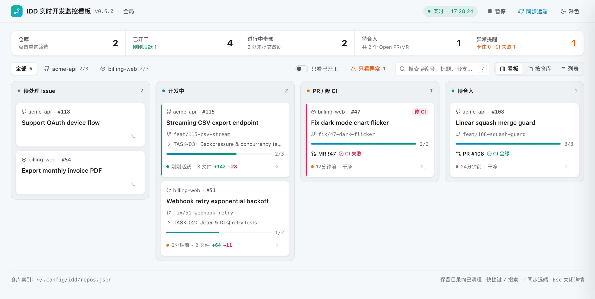
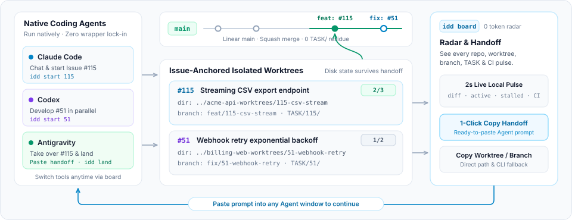

<div align="center">

# IDD

**Issue-Driven Development for Claude Code, Codex, and Antigravity**

**English** · [简体中文](README.zh-CN.md)

[](https://github.com/j-tide/idd/releases)
[](#)
[-8b5cf6?style=flat-square)](#)
[](#)

</div>

<p align="center">
  <picture>
    <source media="(prefers-color-scheme: dark)" srcset="assets/board-dark.png" />
    <source media="(prefers-color-scheme: light)" srcset="assets/board-light.png" />
    
  </picture>
</p>

---

## Why IDD

Turn every idea into an **Issue** before touching code, then unify **branches, Git worktrees, `TASK` ledgers, PR/MR summaries, and linear squash merges** into a single zero-dependency Skill + CLI (`idd`) with native support for **GitHub** and **Self-Hosted GitLab**:

- **Issue-first scoping**: Align boundaries and acceptance criteria in chat and create a GitHub / GitLab Issue cleanly without polluting your working tree.
- **Zero-amnesia cross-tool handoff**: Claude Code, Codex, and Antigravity share the exact same worktree layout and `idd start` contract—switch agents anytime and resume from `TASK/<issue>/` seamlessly.
- **True parallel worktrees**: Each Issue runs in its own isolated worktree and validated branch while automatically syncing `.worktreeinclude` files (such as `.env`).
- **Live observability (Web + Terminal, 0 tokens)**: Track active repositories and lock-free worktree pulses (`idd board` Web Kanban / `idd watch` TUI / `idd status` CLI) without interrupting running agents or spending extra tokens.
- **Always-linear `main`**: Once CI passes, `idd land` rebases onto `main`, writes a structured `TASK` summary into the PR/MR and commit body, removes temporary `TASK/<issue>/` files, and lands via **Squash merge**—while safely keeping branches and worktrees until you run `idd cleanup`.

---

## How It Works

<p align="center">
  <picture>
    <source media="(prefers-color-scheme: dark)" srcset="assets/workflow-dark.svg" />
    <source media="(prefers-color-scheme: light)" srcset="assets/workflow-light.svg" />
    
  </picture>
</p>

Four lightweight steps from idea to linear `main`, with free handoff between AI tools at any point:

1. **Create an Issue**: Discuss scope in any agent window and ask it to open an Issue (or run `idd issue create --title "..."`).
2. **Start or hand off**: Run `idd start <issue#>` in any tool—creates an isolated worktree and syncs `.env` on first run, or idempotently reuses the existing worktree and `TASK/` progress when another tool takes over.
3. **Break down `TASK`, test for real, open PR / MR**: Follow [SKILL.md](SKILL.md) to split `TASK/<issue>/TASK-XX.md`, verify and commit each step (`idd sync` pushes a live checklist back to the Issue body), then run `idd pr` (or `idd mr` on GitLab). If CI fails, run `idd ci --logs` to inspect failing job logs.
4. **Land linearly onto `main`**: Once verified and CI is green, run `idd land <issue#>` to rebase, summarize `TASK` records, strip `TASK/<issue>/`, and Squash-merge into `main`. Feature branches and worktrees are preserved by default.

*(Recommended once per repository: run `idd repo-init --apply` to enforce Squash-only linear merges on GitHub or `ff` + `squash` on GitLab while keeping branches.)*

---

## Live Observability (Web & Terminal)

`idd` automatically indexes active local repositories in `~/.config/idd/repos.json` and inspects worktree pulse metrics (active task, dirty diff stats, heartbeat, and stall detection) with zero token overhead:

- **`idd board` / `idd ui`**: Offline single-page Web dashboard with Kanban, Repo, and List views, light/dark themes, and 2-second pulse polling.
- **`idd watch`**: Live terminal monitor refreshing local worktree pulse every 2 seconds and remote PR/MR CI on a 30-second cache.
- **`idd status`**: One-shot summary card in the terminal (automatically switches to global mode outside a Git repo).

<p align="center">
  
</p>

---

## Install & Uninstall

Prerequisites: `git` and `python3` (`gh` authenticated for GitHub; `idd auth login <host> --token <PAT>` for self-hosted GitLab).

```bash
# Install or repair skill links (Claude Code / Codex / Antigravity) and ~/.local/bin/idd
curl -fsSL https://raw.githubusercontent.com/j-tide/idd/main/install.sh | sh

# Cleanly remove all symlinks, skill repository, config, and cache (never touches project repos)
idd uninstall
```

> `idd` safely checks `origin/main` in the background every 6 hours and fast-forwards only when your local skill repo is on a clean `main` branch (or run `idd upgrade [--check]`). `idd uninstall` supports `--dry-run`, `--keep-config`, and `-y`; if the CLI is unavailable, run `curl -fsSL https://raw.githubusercontent.com/j-tide/idd/main/install.sh | sh -s -- --uninstall -y`.

---

## CLI Reference & Branch Conventions

### Common Commands

| Command | Description |
| :--- | :--- |
| `idd board` / `idd ui` | Start the local offline Web dashboard (2s live worktree pulse across all repos) |
| `idd watch [--current-only]` | Live terminal monitor for global or single-repo worktrees, tasks, and CI |
| `idd status [-g\|--global]` | Aggregate Open Issues, `TASK` progress, pulse, and PR/MR CI in one view |
| `idd repos [list\|add\|remove\|prune]` | Inspect or manage the global monitored repository index (`~/.config/idd/repos.json`) |
| `idd issue create --title "..."` | Create a GitHub or GitLab Issue |
| `idd start <issue# \| slug>` | Create or idempotently reuse an isolated worktree, sync `.worktreeinclude`, and validate branch naming |
| `idd sync [issue#]` | Sync local `TASK` checklist progress back to the Issue body |
| `idd pr` / `idd mr` | Summarize `TASK` and test records (`Closes #id`) to create or update a PR / MR |
| `idd ci [issue# \| pr# \| !mr#] [--logs]` | Check PR / MR CI status and fetch failing job logs |
| `idd land [issue# \| slug]` | Rebase, clean `TASK/<issue>/`, and Squash-merge onto `main` (keeps branches & worktrees by default; optional `--rm-worktree`) |
| `idd cleanup [--dry-run]` | Safely remove merged worktree directories when clean and `HEAD == headRefOid` (**never deletes branches**) |
| `idd repo-init [--apply]` | Check or apply linear Squash merge rules with branch retention on GitHub / GitLab |
| `idd auth login / status / logout` | Manage credentials for self-hosted GitLab or GitHub Enterprise hosts |
| `idd upgrade [--check]` | Check for updates or fast-forward `idd` (`idd --version` prints current version) |
| `idd uninstall [--dry-run] [--keep-config] [-y]` | Completely remove `idd` symlinks, skill clone, config, and cache |

### Branch Naming (Zero Git Hooks)

Branches and commit `<type>` tags share **8 standard prefixes** (`<type>/<issue#>-<slug>` for Issue worktrees, `<type>/<slug>` for local-only branches):

`feat` · `fix` · `refactor` · `perf` · `docs` · `test` · `ci` · `chore`

> `idd` blocks non-standard prefixes such as `codex/*`, `claude/*`, `agy/*`, `feature/*`, `bugfix/*`, and `tmp/*` with an exact `git branch -m` fix command—without installing any Git hooks in your repositories.

---

## Development, Testing & Releases

Zero external dependencies—run the full Python standard-library test suite directly, with [SKILL.md](SKILL.md) (`metadata.version`) as the single source of truth:

```bash
# Run all unit tests
python3 -m unittest discover -s tests -v

# Verify version consistency across SKILL.md, READMEs, and `idd --version`
python3 scripts/release.py --check

# Release milestone: bump version, run full tests, commit, and create annotated tag
python3 scripts/release.py minor --tag
git push origin main v0.7.0
```

> Pushing a `vX.Y.Z` tag triggers GitHub Actions to validate versions, run the full test suite, and publish a GitHub Release, while end users continue syncing `origin/main` safely via `idd upgrade`.
