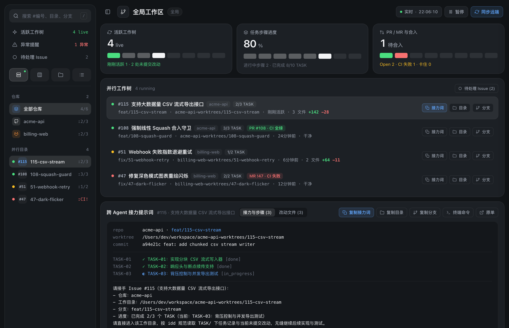

<div align="center">

# IDD

**让 Claude Code、Codex 与 Antigravity 各自独立并行、互不打扰；在本地看板看清每个 Worktree 进度，一键复制上下文换任意 Agent 接着做。**

**简体中文** · [English](README.en.md)

[](https://github.com/j-tide/idd/releases)
[](#)
[-8b5cf6?style=flat-square)](#)
[](#)

</div>

<p align="center">
  <picture>
    <source media="(prefers-color-scheme: dark)" srcset="assets/board-zh-dark.png" />
    <source media="(prefers-color-scheme: light)" srcset="assets/board-zh-light.png" />
    
  </picture>
</p>

---

## IDD 解决什么问题

同时开几个 AI 编程工具干活时，最常见两个痛点：大家挤在同一个目录里容易互相改乱代码；某一个 Agent 额度耗尽或卡住时，对话上下文也跟着锁死在那个窗口里。

**IDD 不把你绑进重型套壳客户端**——你依然在各自原生顺手的窗口里用 Claude Code、Codex 和 Antigravity，底层靠三件事串成闭环：

- **统一研发规范（`SKILL.md` Skill）**：让三个工具遵循同一套约定——先用 GitHub / GitLab **Issue** 锚定需求，再为每个 Issue 开出独立 **Git Worktree**，把拆分步骤与进度记在工作树里的 `TASK/<issue>/` 账本中。
- **全局进度雷达与接力跳板（`idd board`）**：零 Token 实时总览所有仓库和并行需求——一眼看清哪个需求在**哪个 Worktree 目录、哪个分支、做到第几个 `TASK`、CI 过没过**；想换工具时，点一下 **「复制接力词」**（或直接复制工作目录路径 / 分支名），切到另一个 Agent 窗口粘贴就能接着做（看板支持中英文切换）。
- **幕后确定性引擎（`idd` CLI）**：主要供 Agent 自动调用，把 `worktree` 创建、`.worktreeinclude`（`.env`）同步、8 类分支命名拦截、PR/MR 汇总、CI 失败日志拉取与 **Squash 直线合入 `main`** 封装成安全动作，平时无需背命令。

---

## 日常怎么用

<p align="center">
  <picture>
    <source media="(prefers-color-scheme: dark)" srcset="assets/workflow-zh-dark.svg" />
    <source media="(prefers-color-scheme: light)" srcset="assets/workflow-zh-light.svg" />
    
  </picture>
</p>

1. **聊想法，先立一个 Issue 锚点**：在任意 Agent 窗口聊清需求范围，直接说 *「按 idd 建个 Issue」*，不污染当前代码工作区。
2. **多 Agent 各做各的、互不打扰**：让 **Claude Code** *「开工 #115」*，同时让 **Codex** *「开工 #51」*。每个需求自动进独立的物理 Worktree 目录和规范分支，自动复制 `.env` 并各自维护 `TASK/` 进度。
3. **打开 `idd board` 盯进度，随时一键换手**：通过看板看改动行数、当前步骤和 CI 状态。需要换工具接着做时，在卡片或接力控制台点击 **「复制接力词」**（或直接复制目录/分支），贴进 **Antigravity** 等任意另一个 Agent 对话框即可无缝续写。
4. **验收通过，干净 Squash 合入 `main`**：在最后一个 Agent 里说 *「合入 #115」*，自动 rebase、把 `TASK` 汇总写入 PR/MR 与提交正文、清理临时 `TASK/<issue>/` 目录后以单条直线提交合入 `main`——默认保留需求分支与工作树，空间不够时再运行 `idd cleanup`。

*(首次接管仓库建议执行一次 `idd repo-init --apply`，锁定 GitHub 仅 Squash 合入或 GitLab `ff` + `squash` 策略并保留分支。)*

---

## 快速开始

前置条件：本机已安装 `git` 与 `python3`（GitHub 仓库需登录 `gh`；自建 GitLab 安装后执行 `idd auth login <host> --token <PAT>`）。

```bash
# 1. 一键安装 Skill（挂载到 Claude Code / Codex / Antigravity）与全局 `idd` CLI
curl -fsSL https://raw.githubusercontent.com/j-tide/idd/main/install.sh | sh

# 2. 启动本地进度雷达与一键接力看板
idd board
```

> 每 6 小时会在后台安全检查并快进同步 `origin/main`（仅当本地技能仓库位于干净 `main` 分支时更新，也可手动 `idd upgrade [--check]`）。随时可运行 `idd uninstall`（或兜底脚本 `curl -fsSL https://raw.githubusercontent.com/j-tide/idd/main/install.sh | sh -s -- --uninstall -y`）安全清理，绝不影响业务仓库。

---

<details>
<summary><strong>CLI 命令与分支规范速查</strong>（主要由 Agent 自动调用，也可在终端手动运行）</summary>

### 常用命令

| 命令 | 说明 |
| :--- | :--- |
| `idd board` / `idd ui` | 启动本地离线 Web 进度雷达与一键接力看板（每 2 秒刷新脉搏，支持中/英切换） |
| `idd watch [--current-only]` | 在终端按 2 秒频率实时刷新全局（或当前仓库）Worktree 脉搏、当前 TASK 与 CI |
| `idd status [-g\|--global]` | 终端一次性输出 Open Issues、Worktree `TASK` 进度、脉搏与 PR/MR CI |
| `idd repos [list\|add\|remove\|prune]` | 查看或管理全局自动监控的仓库索引（`~/.config/idd/repos.json`） |
| `idd issue create --title "..."` | 创建 GitHub / GitLab Issue |
| `idd start <issue# \| slug>` | 创建或幂等复用独立 Worktree，同步 `.worktreeinclude` 并校验分支名 |
| `idd sync [issue#]` | 将本地 `TASK` 勾选进度同步回 Issue 正文 |
| `idd pr` / `idd mr` | 汇总 `TASK` 与测试记录（附 `Closes #id`）创建或更新 PR / MR |
| `idd ci [issue# \| pr# \| !mr#] [--logs]` | 检查 PR / MR 的 CI 状态并拉取失败日志 |
| `idd land [issue# \| slug]` | Rebase、清理 `TASK/<issue>/` 并 Squash 直线合入（默认保留分支与工作树，可选 `--rm-worktree`） |
| `idd cleanup [--dry-run]` | 按需清理工作区干净且 `HEAD == headRefOid` 的已合入工作树目录（**不删分支**） |
| `idd repo-init [--apply]` | 检查或配置 GitHub / GitLab 为线性 Squash 合入策略且保留分支 |
| `idd auth login / status / logout` | 管理自建 GitLab / GitHub 企业版主机凭据 |
| `idd upgrade [--check]` | 检查或立即快进更新本地 `idd`（`idd --version` 查看当前版本） |
| `idd uninstall [--dry-run] [--keep-config] [-y]` | 安全完全卸载 `idd`（移除软链、技能仓库、配置与缓存） |

### 分支规范（零 Git Hooks 侵入）

分支前缀与 Commit `<type>` 共用以下 **8 类标准词表**（绑定 Issue 为 `<type>/<issue#>-<slug>`，纯本地为 `<type>/<slug>`）：

`feat` · `fix` · `refactor` · `perf` · `docs` · `test` · `ci` · `chore`

`idd` 内置拦截 `codex/*`、`claude/*`、`agy/*`、`feature/*`、`bugfix/*`、`tmp/*` 等不规范前缀，并在报错时给出标准 `git branch -m` 修复命令，不在业务仓库写入任何 Git Hook。

</details>

---

## 开发、测试与发版

零外部依赖，使用 Python 3 标准库直接运行全部单元测试，并以 [SKILL.md](SKILL.md) 中的 `metadata.version` 作为唯一版本源：

```bash
python3 -m unittest discover -s tests -v
python3 scripts/release.py --check
python3 scripts/release.py patch --tag && git push origin main && git push origin v0.0.2
```
