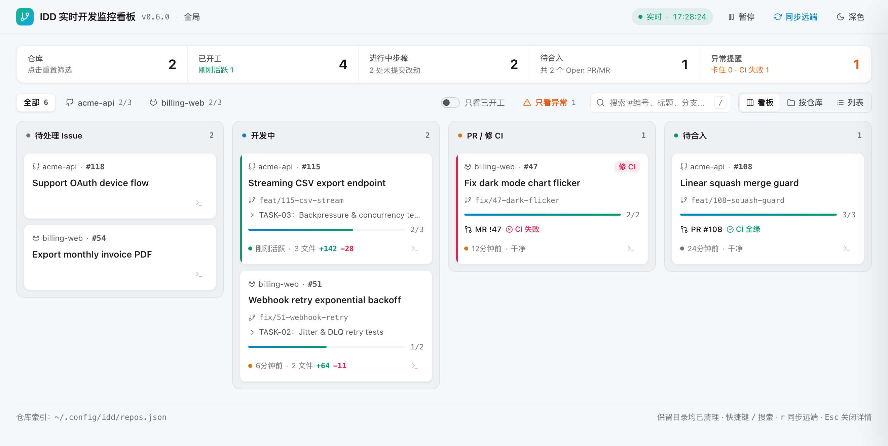
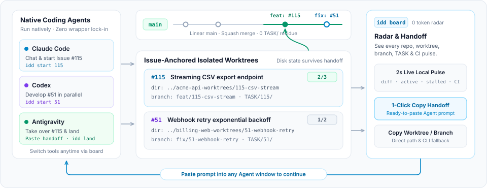
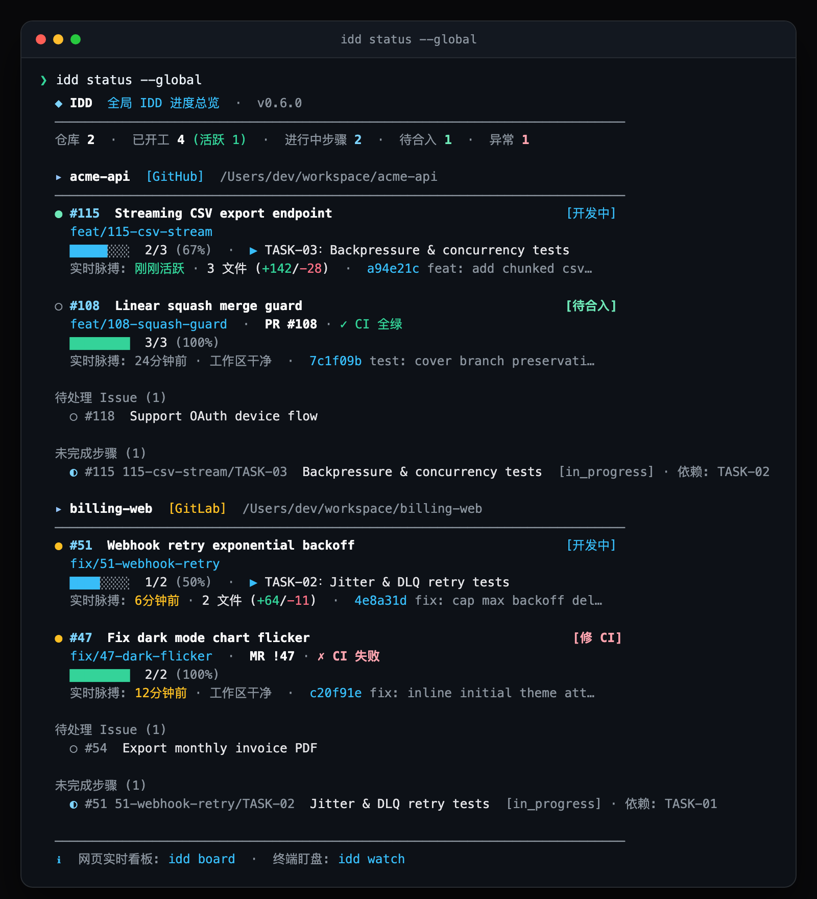

<div align="center">

# IDD

**让 Claude Code、Codex 与 Antigravity 共用同一套 Issue 驱动开发流水线**

[English](README.md) · **简体中文**

[](https://github.com/j-tide/idd/releases)
[](#)
[-8b5cf6?style=flat-square)](#)
[](#)

</div>

<p align="center">
  <picture>
    <source media="(prefers-color-scheme: dark)" srcset="assets/board-dark.png" />
    <source media="(prefers-color-scheme: light)" srcset="assets/board-light.png" />
    
  </picture>
</p>

---

## 为什么选择 IDD

写代码前先把想法变成 **Issue**，再把**分支、Worktree 目录、`TASK` 账本、PR/MR 汇总与直线合入**收口到零外部依赖的 Skill + CLI（`idd`）中，**原生支持 GitHub 与自建 GitLab**：

- **聊想法自动建单**：在任意 AI 窗口对齐需求边界与验收标准后一键创建 GitHub / GitLab Issue，不污染当前工作区。
- **多工具零失忆接力**：Claude Code、Codex 与 Antigravity 共用同一套目录规范与 `idd start`，随时切换工具进入同一个 Worktree 读取 `TASK/<issue>/` 无缝续写。
- **独立 Worktree 真并行**：每个 Issue 拥有物理隔离的工作树与规范分支，多需求并行互不干扰，自动同步 `.worktreeinclude`（如 `.env`）。
- **全局实时监控（Web + 终端，零 Token）**：自动索引本机活跃仓库并无锁探测 Worktree 脉搏（`idd board` 网页看板 / `idd watch` 终端面板 / `idd status` 状态卡片），**不打断当前对话，也不额外消耗 Token**。
- **`main` 永远是一条直线**：CI 通过后执行 `idd land`，自动 rebase、汇总 `TASK` 写入描述与提交正文、清理 `TASK/<issue>/` 后以 **Squash 直线合入 `main`**——同时**默认保留分支与工作树**，释放空间时再运行经安全校验的 `idd cleanup`。

---

## 工作流一览

<p align="center">
  <picture>
    <source media="(prefers-color-scheme: dark)" srcset="assets/workflow-dark.svg" />
    <source media="(prefers-color-scheme: light)" srcset="assets/workflow-light.svg" />
    
  </picture>
</p>

平时只需要四步，全程可在任意 AI 编程工具之间自由切换：

1. **聊天建单**：在任一工具里对齐需求后让它建单（或直接 `idd issue create --title "..."`）。
2. **开工 / 接手**：让任意工具执行 `idd start <issue#>`——首次运行自动创建独立 Worktree 并同步 `.env`；换工具接手时再次运行自动幂等复用同一工作树与 `TASK/` 进度。
3. **拆任务、真测试、提 PR / MR**：按 [SKILL.md](SKILL.md) 拆出 `TASK/<issue>/TASK-XX.md` 逐项验证提交（运行 `idd sync` 可把勾选进度条同步回 Issue 正文），完成后运行 `idd pr`（GitLab 也可用 `idd mr`）；CI 挂了执行 `idd ci --logs` 自动拉取失败日志定位修复。
4. **直线合入 `main`**：验收通过且 CI 全绿后执行 `idd land <issue#>`，自动 rebase、把结构化汇总写入 PR/MR 与提交正文、清理 `TASK/<issue>/` 后以单条 Squash 提交直线合入 `main`，默认保留需求分支与工作树。

*(首次接管仓库建议运行一次 `idd repo-init --apply`，锁定 GitHub 仅 Squash 合入或 GitLab `ff` + `squash` 策略并保留分支。)*

---

## 实时监控（Web 看板与终端）

`idd` 会在 `~/.config/idd/repos.json` 自动记录本机活跃仓库，并无锁采集实时工作树脉搏（当前任务、未提交改动行数、活跃时间与疑似卡住提醒）：

- **`idd board` / `idd ui`**：零依赖离线 Web 看板，支持看板 / 按仓库 / 列表视图、浅深色主题切换与每 2 秒自动刷新。
- **`idd watch`**：终端实时监控面板，2 秒刷新本地脉搏、30 秒缓存远端 PR/MR CI 状态。
- **`idd status`**：终端输出结构化进度卡片（在非 Git 目录自动切为全局总览）。

<p align="center">
  
</p>

---

## 安装与卸载

前置条件：本机已安装 `git` 与 `python3`（GitHub 仓库需登录 `gh`；自建 GitLab 安装后执行 `idd auth login <host> --token <PAT>`）。

```bash
# 一键安装（克隆仓库并挂载到 Claude Code / Codex / Antigravity 与 ~/.local/bin/idd）
curl -fsSL https://raw.githubusercontent.com/j-tide/idd/main/install.sh | sh

# 安全完全卸载（移除所有软链、技能仓库、配置与缓存；绝不影响业务仓库）
idd uninstall
```

> 每 6 小时会在后台安全检查并快进同步 `origin/main`（仅当本地技能仓库处于干净 `main` 分支时自动更新，也可手动执行 `idd upgrade [--check]`）。卸载支持 `--dry-run` 预览、`--keep-config` 保留配置与 `-y` 免确认；若 `idd` 已不可用，可执行 `curl -fsSL https://raw.githubusercontent.com/j-tide/idd/main/install.sh | sh -s -- --uninstall -y` 兜底清理。

---

## 命令速查与分支规范

### 常用命令

| 命令 | 说明 |
| :--- | :--- |
| `idd board` / `idd ui` | 启动本地 Web 实时监控看板（零依赖离线网页，每 2 秒刷新所有活跃仓库与脉搏） |
| `idd watch [--current-only]` | 在终端按 2 秒频率实时刷新全局（或当前仓库）Worktree 脉搏、当前 TASK 与 CI 状态 |
| `idd status [-g\|--global]` | 一张视图聚合 Open Issues、Worktree `TASK` 进度、实时脉搏与 PR/MR CI |
| `idd repos [list\|add\|remove\|prune]` | 查看或管理全局自动监控的仓库索引（`~/.config/idd/repos.json`） |
| `idd issue create --title "..."` | 创建 GitHub / GitLab Issue |
| `idd start <issue# \| slug>` | 创建或幂等复用独立 Worktree，同步 `.worktreeinclude` 并校验分支名 |
| `idd sync [issue#]` | 将本地 `TASK` 勾选进度同步回 Issue 正文 |
| `idd pr` / `idd mr` | 汇总 `TASK` 与测试记录（附 `Closes #id`）创建或更新 PR / MR |
| `idd ci [issue# \| pr# \| !mr#] [--logs]` | 检查 PR / MR 的 CI 状态并拉取失败日志 |
| `idd land [issue# \| slug]` | Rebase、清理 `TASK/<issue>/` 并 Squash 直线合入（默认保留分支与工作树，可选 `--rm-worktree`） |
| `idd cleanup [--dry-run]` | 按需清理工作区干净且 `HEAD == headRefOid` 的已合入工作树目录（**不删分支**） |
| `idd repo-init [--apply]` | 检查或配置 GitHub / GitLab 为线性 Squash 合入策略且保留分支 |
| `idd auth login / status / logout` | 管理自建 GitLab / GitHub 企业版主机凭据 |
| `idd upgrade [--check]` | 检查或立即快进更新本地 `idd`（`idd --version` 查看当前版本） |
| `idd uninstall [--dry-run] [--keep-config] [-y]` | 安全完全卸载 `idd`（移除软链、技能仓库、配置与缓存） |

### 分支规范（零 Git Hooks 侵入）

分支前缀与 Commit `<type>` 共用以下 **8 类标准词表**（绑定 Issue 为 `<type>/<issue#>-<slug>`，纯本地为 `<type>/<slug>`）：

`feat` · `fix` · `refactor` · `perf` · `docs` · `test` · `ci` · `chore`

> `idd` 内置拦截 `codex/*`、`claude/*`、`agy/*`、`feature/*`、`bugfix/*`、`tmp/*` 等不规范前缀，并在报错时给出标准 `git branch -m` 修复命令，不在业务仓库写入任何 Git Hook。

---

## 开发、测试与发版

零外部依赖，使用 Python 3 标准库直接运行全部单元测试，并以 [SKILL.md](SKILL.md) 中的 `metadata.version` 作为唯一版本源：

```bash
# 运行全部单元测试
python3 -m unittest discover -s tests -v

# 校验 SKILL.md、中英文 README 徽章与 idd --version 一致性
python3 scripts/release.py --check

# 发版里程碑：自动递增版本、跑全量测试、提交并打注释 Tag
python3 scripts/release.py minor --tag
git push origin main v0.7.0
```

> 推送 `vX.Y.Z` Tag 后，GitHub Actions 会自动校验版本、运行全量测试并创建 GitHub Release；平时用户侧的 `idd upgrade` 与后台 6 小时自动同步仍安全快进跟踪 `origin/main`。
