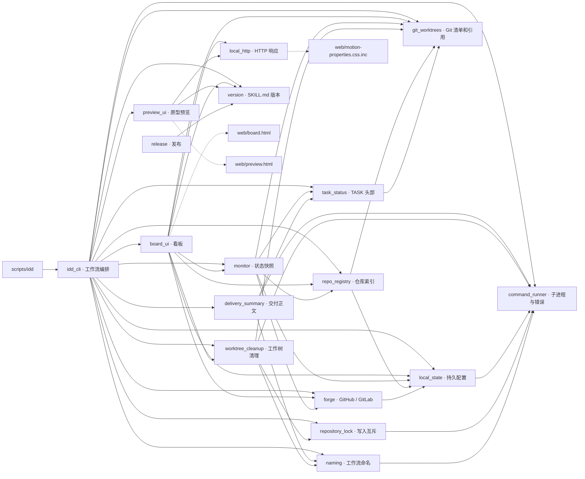

# IDD 架构与维护决策

IDD 把一次需求的工作保存在 Issue、Git 工作树和 TASK 文件中。CLI 对这些系统执行操作，监控把已有事实组合成快照，看板和终端展示同一份快照。项目运行使用 Python 标准库、Git 和 POSIX shell。GitHub 操作使用 `gh`。GitLab 主要使用 HTTP，缺少令牌且已安装 `glab` 时，部分 API 请求与 MR 查询可以使用 `glab`。

## 模块与依赖

下图覆盖当前代码库中 18 个 Python 模块与入口的全部 45 条内部导入。实线指向被依赖的模块，虚线指向页面和样式资源。`tests/test_architecture.py` 从实际的 Python 导入构建依赖图，检查环和跨模块私有访问。

| 修改内容 | 先看哪里 | 入口和约束 |
| --- | --- | --- |
| 命令参数、工作树创建、同步、CI、合入、安装生命周期 | `scripts/idd_cli.py`、`install.sh` | `scripts/idd` 是安装后软链的目标。`pr` 和 `land` 共用合入流程，仓库锁覆盖会竞争的操作。 |
| 任务和命名 | `task_status.py`、`naming.py` | 任务状态来自头部。旧 `Goal`、`--goal`、数字目录和游离 HEAD 有真实调用或回归用例。八种类型同时用于 CLI 参数、Issue 标题、分支校验和清理资格。 |
| Git 事实与清理 | `git_worktrees.py`、`worktree_cleanup.py`、`repository_lock.py` | 清单保留 Git 的顺序，第一项是主工作树。清理使用当前分支、干净工作区和远端已合入记录的 `headRefOid`。`command_runner.py` 负责需要向用户报告失败的外部命令。 |
| 平台读写和交付正文 | `forge.py`、`delivery_summary.py` | Forge 归一 Issue、PR/MR、CI 字段及错误。汇总器读取 TASK 与提交记录，为同一批验证记录生成 Markdown 和纯文本。 |
| 状态读取与展示 | `monitor.py`、`repo_registry.py`、`local_state.py` | CLI、看板和终端从公开接口读取快照、登记信息和全局设置。显示一次状态可以登记已经识别的仓库。 |
| 页面与本地 HTTP | `scripts/web/`、`board_ui.py`、`preview_ui.py`、`local_http.py` | 页面按 UTF-8 随安装交付。加载时内联共享的 CSS 动效属性，无前端构建步骤或额外的浏览器请求。两个服务共用响应头、JSON 写出和客户端断连处理。看板拥有写接口的请求校验，预览拥有文件访问范围与 MIME 判定。 |
| 版本、安装与发布 | `version.py`、`release.py`、`install.sh`、`.github/workflows/` | `SKILL.md` 的 `metadata.version` 是版本源。中英文 README 徽章、CLI 和发布标签可交叉校验。shell 卸载后备路径用于 Python 入口已缺失的安装。 |

## 状态所有权

| 事实或状态 | 权威来源与写入方 | 读取和失效 |
| --- | --- | --- |
| TASK 生命周期、依赖、验证说明 | 工作树中的 `TASK/<issue>/TASK-*.md`，开发者或 Agent 写入 | `task_status` 读取头部。Issue 进度块由 `sync` 从这些文件派生。 |
| 分支指向、提交、工作区改动 | Git 引用、对象和索引 | CLI 按命令读取。监控使用带超时的无可选锁探测，并按文件签名和 TTL 缓存结果。 |
| 合入资格、平台检查和失败日志 | GitHub/GitLab 的 PR/MR、流水线和远端提交 | `forge` 保留平台各自的检查语义，`monitor` 缓存读结果。合入路径重查目标和流水线状态。 |
| 全局自动准入和主机授权 | `config.json` 和 `hosts.json`，由 `local_state` 持锁修改 | `pr` 在执行时读取全局开关。主机更新保留其他记录，凭据文件权限为 `0600`。损坏文件在修改时报错并保留原始字节。 |
| 活跃仓库与初始化结果 | `repos.json`，由 `repo_registry` 维护 | 支持旧的顶层列表和当前对象格式。后台登记可退化为内存结果。列表读取成功时，即使自动剪枝写入失败也返回有效项。显式剪枝要求成功保存。 |
| 进程内快照与平台身份 | `monitor` 的工作树、Forge 和身份探测缓存，`board_ui` 的 HTTP 响应缓存 | 相同请求可以合并。登录状态失效后，旧探测只能结算自己的等待者，不能覆盖新值。 |
| 升级检查、页面偏好 | `update_state.json` 记录最近升级检查，浏览器本地存储保存语言、主题和视图，会话存储保存最近快照 | 升级缓存写失败按既有策略处理。前端偏好不参与工作流决策。 |

主机配置和仓库索引默认位于 `~/.config/idd/`。配置锁保护一次读取、修改和写回。仓库锁位于 Git 公共目录，保护多个工作树之间的写操作。同一线程可以重入，其他线程和进程需等待。文件锁的跨进程保证由 POSIX `flock` 提供。

## 错误、重试与诊断

CLI 使用显式退出码报告预期错误。合入流程区分未完成任务、冲突、等待超时和 CI 失败，保留出错的操作上下文。GitLab 适配器向重试逻辑传递 HTTP 状态并关闭失败响应，`idd ci --logs` 从相应平台获取失败日志。自动准入持仓库级合入锁，等待落后时的重变基与重试次数受上限控制。

本地 HTTP 服务忽略已经断开的客户端连接，其他 I/O 异常仍走标准错误处理。看板写操作在执行前检查请求来源，主机配置无法安全读写时向调用方返回错误。`TASK` 验证记录、Git 提交和平台 CI 是可保留的执行证据。

## 已采纳的决策

| 决策 | 已迁移的调用方与理由 | 回归证据 |
| --- | --- | --- |
| 工作树清单和分支类型各保留一个实现 | TASK 工具、CLI、监控和看板均从 Git 能力或命名模块取值。把 TASK 工具接入完整监控会引入平台和缓存依赖。 | 真实工作树、含空格与中文的路径、游离 HEAD、安装后的 CLI 和分支命名测试。 |
| 实际清理在锁内复核，预览直接读取 | 查询已合入记录后，重新核对工作树归属、分支、改动和 HEAD。远端网络请求在锁外。CLI 批量清理和看板单项清理各自保留输出形式。 | 双线程重复清理、预览期间持锁、分支变化、脏工作区和 HEAD 不匹配。 |
| 缓存只由拥有探测逻辑的模块失效 | CLI、看板和后台任务使用稳定接口。身份探测共享一次查询，启动失败和同步中断能结束等待。 | 缓存失效时竞态、线程启动失败、Git 子进程预算、HTTP 并发请求合并。 |
| 交付记录一次解析，两种格式单独渲染 | 两种输出分别满足平台展示与 Git 正文契约。GitHub 的五个正文写入操作共用临时文件管理。 | 真实提交生成的 Markdown 表格、长命令、转义、纯文本空行和双平台合入测试。 |
| 页面源码与 HTTP 服务独立维护 | 前端改动可以直接编辑 HTML。服务端改动可以直接编辑处理器。安装测试复制真实运行目录并访问两个已安装页面。 | 页面提取前后字节对照、真实 HTTP 启动、Node 运行页面脚本、安装与卸载测试。 |
| 共享动效规范只有一个来源 | 两个页面从同一 CSS 声明片段获得 13 项缓动、时长和按压缩放属性。颜色、布局和各页面的减少动态效果规则仍归相应页面。 | 对照基线页面完整字节，检查两个真实页面及其动效行为。 |
| 持久配置和派生快照各有所有者 | 原子替换避免部分写入，持锁读改写避免另一进程的记录丢失。仓库初始化的显式请求、首次登记和后台观察保留各自的触发时机。 | 多进程主机更新、注册表并发、文件权限、损坏输入和写失败测试。 |

## 优化任务池

已实施批次及验证记录保存在治理 Issue 和关联提交中。以下决定会改变可观察行为，保留为待确认项。[Issue #81](https://github.com/j-tide/idd/issues/81)

| 待确认 | 当前边界 | 作决定所需的信息 |
| --- | --- | --- |
| 看板是否采纳 `IDD_WORKTREE_ROOT` 扩大清理范围 | CLI 遵循显式目录覆盖，看板沿用默认同级目录和规范分支范围。 | 是否允许本机配置扩展浏览器可清理目录。 |
| 快照是否公开机器可读的阶段标识 | 现有终端、页面和 JSON 客户端使用各阶段的显示文本。 | 外部快照消费者清单和字段演进约定。 |
| 是否要求原生无 `fcntl` 平台具备跨进程互斥 | 当前安装和 CI 覆盖 POSIX，Python 保留既有的平台回退。 | 受支持平台矩阵和对应的原生并发验收环境。 |

## 验证入口

在仓库根目录执行 `python3 -m unittest discover -s tests -v` 与 `python3 scripts/release.py --check`。测试使用临时 Git 仓库、平台模拟服务、隔离的安装目录和真实 HTTP。页面脚本测试还使用 Node。`tests/test_architecture.py` 随同一套件运行。
